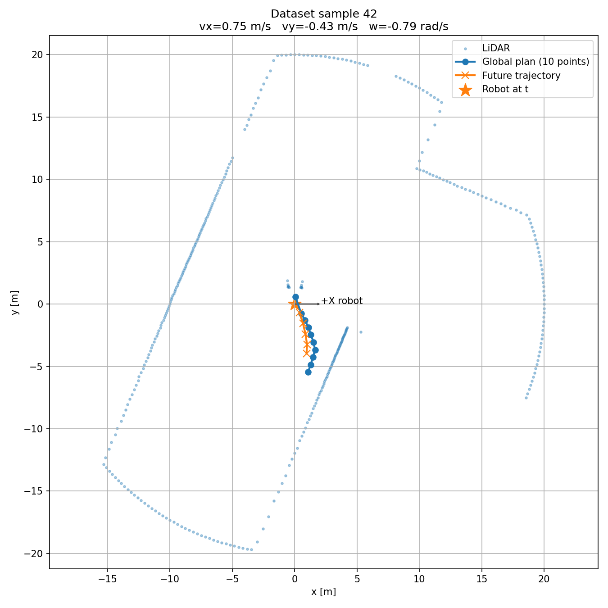
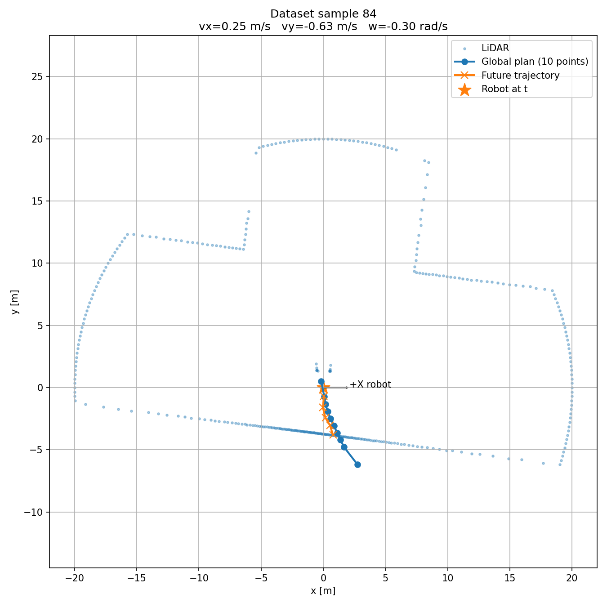

## What I did this week

This week I focused mainly on **validating and extending the dataset generation pipeline**.

First, I analyzed the first dataset generated last week, which contained **169 supervised samples**. I created a validation script to visually inspect different samples and verify that the LiDAR, global plan and future trajectory were correctly aligned in the robot frame.



During this validation, I also updated the odometry input. Since the robot is currently configured as **holonomic**, the network input now contains:

```text
(vx, vy, w)
```

instead of only `(v, w)`.

This allows the dataset to represent lateral motion correctly.



## Human demonstrations

I also studied how demonstrations were generated in the Stanford work.

Their dataset contains **1446 expert trajectories**, including **600 human demonstrations** collected using a gamepad.

For our project, we still need to decide whether to include human demonstrations. One possible option is to use ROS 2 teleoperation, for example `teleop_twist_keyboard`, while recording the same information that we already use for the autonomous expert demonstrations.

## Automatic generation of expert trajectories

Another important improvement this week was automating the generation of new demonstrations.

Instead of manually sending a goal and starting a rosbag for every trajectory, I selected several **2D Goal Poses in RViz2** and extracted their positions and orientations.

I then created a `scenario_runner.py` script that automatically:

```text
starts rosbag
    ↓
sends a NavigateToPose goal to Nav2
    ↓
waits for the trajectory to finish
    ↓
stops rosbag
    ↓
moves to the next scenario
```

Nine goals were tested automatically. Seven trajectories finished successfully, while two reached the timeout and were discarded.

The seven valid recordings were then processed automatically and combined into a new multi-scenario dataset.

The resulting **dataset v1 contains 554 supervised samples**:

```text
Global plan: 10 × (x, y)
LiDAR: 360 ranges
Odometry: (vx, vy, w)

Output:
5 future poses
(x, y, cos(yaw), sin(yaw))
```

Each sample also stores the scenario from which it was generated, which will allow us to separate training and testing by complete trajectories instead of randomly mixing samples from the same trajectory.

## Next steps

The next steps are:

- Study the Stanford neural network architecture in more detail.
- Reproduce and adapt the network to our inputs and outputs.
- Define the train/test split using different expert trajectories.
- Train the first Imitation Learning model and evaluate its predicted trajectories.
- Study the possibility of adding human teleoperated demonstrations.
- Later, migrate the environment to **Ubuntu 26.04, ROS 2 Lyrical and the corresponding Gazebo version**.